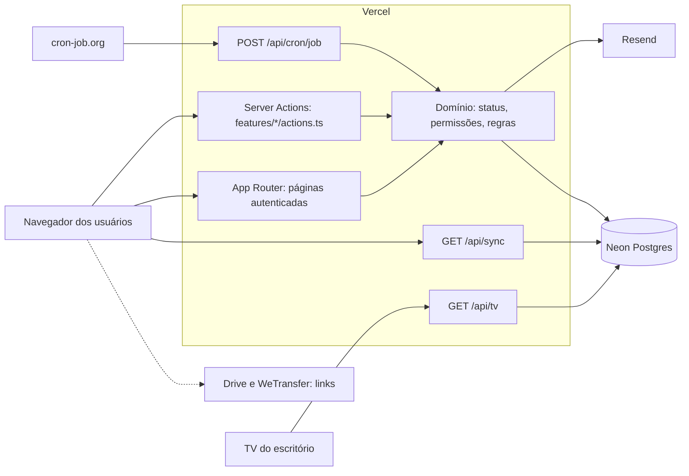

# System Design — LouFlow

> Como o LouFlow é montado fora do Google. Produto em [`prd-louflow.md`](prd-louflow.md), dados em [`schema-postgres.md`](schema-postgres.md), regras de revisão em [`pr-review-guide.md`](pr-review-guide.md).
>
> **Legenda:** **Decidido** = confirmado pelo Mateus (D3, D5, D5b, D8). D2, D6, D7 e a virada *big bang* foram inferidos na descoberta e confirmados em P5 (PRD §7).

---

## 1. Stack

| Camada | Escolha | Status |
|---|---|---|
| Aplicação | Next.js App Router, Server Components e Server Actions, TypeScript | Decidido |
| Hosting | Vercel, plano gratuito | Decidido |
| Banco | Neon Postgres, plano gratuito | Decidido |
| Deploy | ADO Pipeline com `vercel deploy --prebuilt`: PR → preview, merge em `main` → produção | Decidido |
| Repo | `loumar-tech/louflow-marketing/_git/louflow` | Decidido |
| E-mail | Resend, plano gratuito | Decidido (P5) |
| Agendador | cron-job.org chamando rotas protegidas por segredo | Decidido (P5) |
| Tempo real | Polling HTTP com cache de borda, sem WebSocket | Decidido (P5) |

## 2. Diagrama



## 3. Estrutura do repositório

```
app/
  (auth)/login/            formulário de PIN; (auth)/trocar-pin/ troca obrigatória
  (app)/<modulo>/page.tsx  páginas autenticadas (Server Components), uma pasta por módulo
  tv/                      página pública do Painel de TV
  api/tv/route.ts          [PROTEGIDO] payload público da TV
  api/sync/route.ts        [PROTEGIDO] verificação leve de mudança
  api/cron/[job]/route.ts  [PROTEGIDO] rotinas agendadas
  api/sessao/restaurar/    [PROTEGIDO] restauração pelo Dispositivo Confiável
features/<modulo>/         dono: a fatia do módulo
  actions.ts               Server Actions ('use server'), sempre via criarAcao
  consultas.ts             leituras usadas pelas páginas
  jobs.ts                  handlers de cron do módulo
  components/              UI do módulo
features/acesso/           [PROTEGIDO] login, troca de PIN, sair
features/status/           [PROTEGIDO] máquina de Status
lib/                       [PROTEGIDO] contratos compartilhados
  db.ts                    cliente Postgres e helper de transação
  action.ts                contrato de Server Action
  auth.ts, session.ts, pin.ts
  permissions.ts, modules.ts
  history.ts, audit.ts, error-log.ts, notify.ts, cron.ts, tv.ts
components/                UI compartilhada (ui/, shell/)
db/migrations/             [PROTEGIDO] SQL versionado, só aditivo
db/runner.ts               [PROTEGIDO] runner com checksum
proxy.ts                   [PROTEGIDO] checagem otimista de cookie (Next 16)
scripts/db/                migrate e seed sintético
scripts/migracao/          importação única da planilha (fora do runtime)
```

Regra de dependência: `app/` → `features/` → `lib/` → banco. Componentes de UI **nunca** importam `lib/db.ts`.

## 4. Substituição do `google.script.run`

**Antes:** o cliente chama uma função global do Apps Script, que recebe `token` como primeiro argumento:

```
google.script.run.withSuccessHandler(cb).atualizarStatus(token, id, status)
```

**Depois:** o componente chama uma Server Action tipada. A Sessão vem do cookie e nunca de um argumento:

```ts
'use server'
export async function atualizarStatus(input: { demandaId: string; status: Status }) {
  const usuario = await exigirSessao()          // 1. sessão
  exigirPermissao(usuario, 'alterarStatus')     // 2. permissão
  return emTransacao(async (tx) => { ... })     // 3. regra + efeitos atômicos
}
```

Contrato de toda Server Action, em ordem fixa:

1. Validar a Sessão.
2. Validar a entrada com um schema.
3. Checar a Permissão.
4. Abrir transação.
5. Aplicar a regra de domínio.
6. Gravar Histórico e Auditoria.
7. Fazer commit.
8. Disparar os efeitos externos (e-mail).
9. Retornar `{ ok, mensagem, dados }`.

Erros de regra viram uma mensagem amigável e não uma exceção crua.

### 4.1 Mapa das 64 funções públicas de produção

Leituras viram Server Components ou queries. Mutações viram Server Actions. Funções de instalação desaparecem.

| Módulo `features/` | Funções de origem | Destino |
|---|---|---|
| `auth` | `fazerLogin`, `verificarSessao`, `restaurarSessaoConfiavel`, `sairDoSistema` | Actions de login e logout; `proxy.ts` + `lib/auth.ts` |
| `demandas` | `carregarAplicativo`, `carregarDadosAba`, `adicionarDemanda`, `editarDemanda`, `excluirDemanda`, `assumirDemanda`, `atualizarPrioridade`, `atualizarDemandasEmLote`, `obterDetalhesDemanda`, `obterFichaDemandaDisponivel` | Server Components por página + Actions |
| `status` | `atualizarStatus`, `concluirDemandaCortes` | Action única sobre a máquina de Status |
| `sync` | `verificarAtualizacoes` | `GET /api/sync` |
| `fichas` | `enviarFichaTecnica` | Action |
| `entregas` | `registrarEntrega`, `avaliarEntrega` | Actions (usam `status`) |
| `colaboracao` | `adicionarComentario` | Action |
| `agenda` | `salvarAgendamentoPostagem`, `salvarAgendamentoManual`, `atualizarSituacaoPostagem`, `atualizarDataAgendamentoPostagem` | Actions |
| `pendencias` | `adiarPendenciasInfluencer` | Action + cron |
| `captacoes` | `salvarCaptacao`, `cancelarCaptacao`, `concluirCaptacao` | Actions |
| `midiaMovel` | `salvarReservaMidiaMovel`, `cancelarReservaMidiaMovel` | Actions |
| `drone` | `salvarUsoDrone`, `cancelarUsoDrone` | Actions |
| `cortes` | `salvarCorte`, `concluirCorte` | Actions |
| `wiki` | `salvarRegraWiki`, `alterarPublicacaoRegraWiki`, `obterFotosCatalogoEquipamentos` | Actions; o catálogo vira um JSON estático |
| `sorteios` | `cadastrarSorteio`, `consultarSorteios`, `registrarRetiradaSorteio` | Actions |
| `preferencias` | `obterPreferenciasNotificacao`, `salvarPreferenciasNotificacao` | Server Component + Action |
| `relatorios` | `obterRelatorioDiario` | Server Component |
| `analista` | `obterStatusAnalistaLouFlow`, `perguntarAoAnalistaLouFlow` | Server Component + Action |
| `usuarios` | `listarUsuariosPainel`, `salvarUsuarioPainel`, `redefinirPinUsuario`, `desligarUsuarioPainel`, `limparMembroAusentePainel` | Actions de administração |
| `governanca` | `listarAuditoriaAdministrativa`, `listarLixeira`, `restaurarDemandaDaLixeira`, `excluirDefinitivamenteDaLixeira`, `registrarErroCliente` | Server Components + Actions |
| `tv` | `obterDadosPainelTv` | `GET /api/tv` |
| eliminadas | `doGet`, `instalarSistema`, `protegerPinsUsuarios`, `ativarAlertasPrazo`, `ativarRotinaEncerramentoAutomatico`, `executarBackupDiario`, `encerrarAgendamentosVencidos`, `importarSorteiosDesde2025` | Roteamento do Next, migrations, cron, backup da Neon e script de migração única |

## 5. Leitura e atualização

**Problema atual:** `carregarAplicativo` lê de 9 a 10 abas inteiras a cada ciclo.

**Destino:**

- Cada página carrega só o que exibe, via query com filtro e índice.
- Tempos de edição vêm de agregação SQL sobre `editing_cycles` e `demand_pauses`, sem varrer o Histórico.

**Polling: mantém o padrão que a produção já usa.**

1. A cada **30 s**, o cliente chama `GET /api/sync?desde=<revisao>`.
2. A resposta traz só `{ alterou, revisao }`.
3. Somente quando `alterou` é verdadeiro, o cliente chama `router.refresh()` e recarrega os Server Components.

**Revisão** = o maior `id` de `history`. Por isso existe esta invariante: **toda mutação de Demanda grava uma linha no Histórico na mesma transação.** Mutação que não grava Histórico fica invisível para os outros usuários.

Módulos sem Demanda (agenda, captações, mídia móvel, drone) são recarregados quando o usuário abre a aba. Uma aba aberta é atualizada a cada **60 s**, que é o intervalo atual.

## 6. Concorrência e invariantes no banco

| Hoje | Destino |
|---|---|
| `LockService.getDocumentLock()` global, com espera de até 30 s | Transação curta + `SELECT … FOR UPDATE` **só na linha da Demanda** afetada |
| Varredura para achar sobreposição de Mídia Móvel | `EXCLUDE USING gist` sobre `tstzrange` com situação `Reservada` |
| Varredura para achar sobreposição de Captação por videomaker | `EXCLUDE USING gist` com `videomaker_id` e `tstzrange` onde a situação é `Agendada` |
| Data de atualização comparada à mão no Drone | Coluna `version` com `UPDATE … WHERE id = $1 AND version = $2`; zero linhas afetadas significa conflito |
| Chave duplicada de drone | Restrição `UNIQUE` |
| Ciclo de Edição aberto em duplicidade | Índice único parcial `WHERE ended_at IS NULL` |

Padrão de transição de Status:

```sql
BEGIN;
SELECT id, status, editor_id FROM demands WHERE id = $1 FOR UPDATE;
-- validar a transição no domínio (features/status/)
UPDATE demands SET status = $2, updated_at = now() WHERE id = $1;
-- abrir/fechar pausa e ciclo, reconciliar entregas
INSERT INTO history (...);
INSERT INTO audit_log (...);       -- se for ação administrativa
COMMIT;
-- depois do COMMIT: e-mail
```

Use o driver serverless da Neon com transação interativa (WebSocket ou pool). O modo HTTP sem transação interativa **não** serve para mutações.

## 7. Sessão e acesso

| Elemento | Hoje | Destino |
|---|---|---|
| Sessão | Token em `CacheService`, TTL 6 h | Cookie `HttpOnly; Secure; SameSite=Lax` com token aleatório; a tabela `session_tokens` guarda **só o digest** do token, com expiração deslizante de 6 h |
| Dispositivo Confiável | `PropertiesService`, 30 dias | Cookie separado de 30 dias + linha em `trusted_devices` (também só o digest) |
| Invalidação por mudança de acesso | `VERSAO_ACESSO_<email>` nas propriedades | `users.access_version`. A Sessão grava a versão vigente, e uma divergência encerra a Sessão |
| Bloqueio de login | 5 tentativas → 900 s | `users.failed_logins` e `users.locked_until`. Para e-mail inexistente, a mesma mensagem genérica |
| PIN | Digest com segredo nas Script Properties | Hash lento de senha, com sal, numa biblioteca padrão de mercado. Pepper numa variável de ambiente da Vercel. **Reset forçado de todos no lançamento** |
| Escopo Prêmios | `validarSessao_(token, 'sorteios')` | Middleware: Perfil Prêmios só alcança `/sorteios` |

Segredos ficam **somente** nas variáveis de ambiente da Vercel e da Pipeline: banco, pepper do PIN, `CRON_SECRET` e chave do Resend. Nunca vão para o repositório, para logs ou para documentos.

## 8. Rotinas agendadas

A produção tem **três** gatilhos de tempo, e não um:

| Rotina | Hoje | Destino |
|---|---|---|
| Encerrar Captações e Reservas vencidas | A cada 5 min e também em cada leitura | `POST /api/cron/encerramentos` a cada 5 min. A leitura também aplica a regra, como hoje. `UPDATE … WHERE fim <= now() AND situacao = ...` é idempotente |
| Pendências do Influencer: prazo padrão de 24 h, lembretes e aviso à administração | A cada 15 min | `POST /api/cron/pendencias` a cada 15 min |
| Alerta de prazo por Editor | Diário às 08:00 | `POST /api/cron/alertas-prazo` diário às 08:00 America/Sao_Paulo |

Contrato de toda rota de cron:

- Exige `Authorization: Bearer $CRON_SECRET`. Sem esse cabeçalho, responde 401.
- É idempotente: rodar duas vezes não duplica e-mails, porque as colunas `*_sent_at` funcionam como trava.
- Termina dentro do limite de execução da função.
- Registra falhas em `error_log`.

O Vercel Cron do plano Hobby roda só uma vez por dia. Por isso um agendador externo atende os três jobs com um só mecanismo.

## 9. E-mail

- O e-mail só sai **depois do commit**. Uma falha de envio não desfaz a operação e é registrada em `error_log`.
- Antes de enviar, o servidor consulta as preferências do destinatário (`notification_preferences`).
- Limite do plano gratuito do Resend: 100 e-mails por dia e 3 000 por mês. Volume estimado: 16 usuários com alertas diários e mudanças de Status, o que fica abaixo do limite. Há um risco: lotes administrativos grandes. Mitigação: o lote envia um resumo, e não um e-mail por Demanda.

## 10. Painel de TV

- `GET /api/tv` é pública e responde com `Cache-Control: public, s-maxage=15, stale-while-revalidate=30`. Dez TVs abertas geram cerca de uma consulta ao banco a cada 15 s.
- O payload vem de um **DTO com lista explícita de campos**. Nenhum e-mail, PIN, Sessão, conteúdo de Ficha Técnica, motivo de Adiamento nem link de material.
- A página `/tv` busca o payload a cada ciclo do carrossel e se recarrega inteira a cada 30 min para pegar uma implantação nova. Esse é o papel que hoje cabe ao `IndexTvShell`.
- O Painel funciona sem cookie e pode ser exibido em iframe.

## 11. Ambientes e deploy

| Ambiente | Gatilho | Banco |
|---|---|---|
| Preview | PR aberto ou atualizado | Branch Neon `preview`, com dados sintéticos e sem dados pessoais |
| Produção | Merge em `main` | Branch Neon principal |

Etapas da Pipeline, em ordem:

1. Instalar dependências.
2. Rodar lint, typecheck e testes.
3. `vercel build`.
4. Só em `main`: aplicar as migrations pendentes.
5. `vercel deploy --prebuilt`, com `--prod` em `main`.

Uma falha em qualquer etapa interrompe o deploy. Migrations rodam **antes** do deploy e são aditivas, para que a versão anterior continue funcionando durante a troca.

Estratégia de branches no ADO: o padrão Loumar é `develop`, `staging`, `main`. Este documento assume só `main` + PRs, conforme D5b. **Pendente de confirmação com o TL** se `develop` deve existir.

## 12. Migração dos dados (execução única)

1. Exportar a planilha de produção. O export fica fora do repositório e é apagado depois do uso.
2. O script em `scripts/migracao/` lê **por nome de cabeçalho, nunca por índice de coluna**, porque a produção tem colunas a mais que o código local.
3. Normalizar o texto de Status, Prioridade e Situação para os valores canônicos. Valor desconhecido **aborta** a importação; o script não o descarta em silêncio.
4. Resolver nomes de Editor e Influencer para Usuários. Nome sem conta vira um Usuário inativo, sem PIN (P4).
5. Converter as permissões que hoje dependem de nome em concessões explícitas.
6. Não migrar: as 71 abas `Backup_*` e os PINs. Os Sorteios antigos dependem de P3.
7. **Ensaio obrigatório** num branch Neon descartável. Comparar a contagem de linhas por aba com a de tabelas antes da virada.
8. Virada: congelar a planilha (somente leitura), importar, liberar o reset de PIN e trocar o link.

## 13. Observabilidade

- `error_log` recebe as falhas do servidor, do cliente e dos crons. Não grava dados pessoais nem cabeçalhos.
- Os logs de execução da Vercel servem para diagnóstico. Payloads de formulário nunca vão para os logs.
